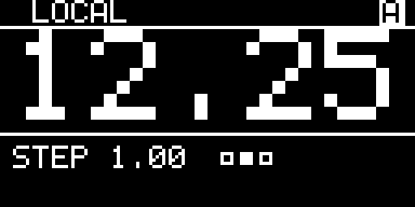
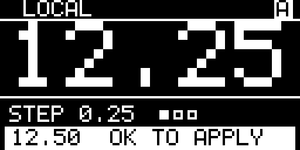
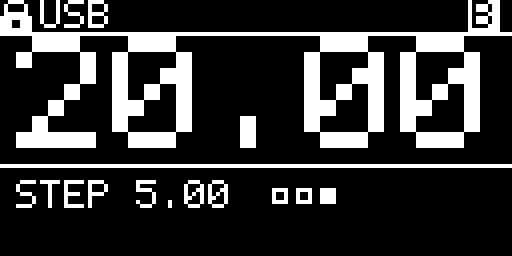
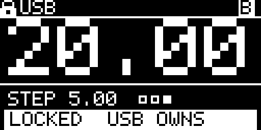
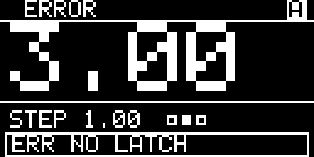
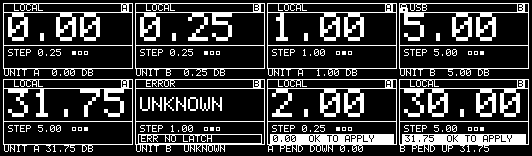

# Applied attenuation screen (v0.5.0)

The 128×64 Stacked Hero screen gives the applied value the largest digits,
with no meter and no trailing unit suffix. All attenuation values are dB.
The top strip spells out `LOCAL`, `USB` or `ERROR`, shows a lock only during
an active USB profile lease, and identifies the unit with an A/B badge.
Boot zero appears as LOCAL; the UART/mailbox source remains BOOT internally.
Acquiring a lease preserves the last applied source, so a LOCAL header with
a lock means a USB profile owns control of a locally applied value. A direct
USB SET shows USB without implying a lease.

The hero is the value published after a complete software latch transaction,
not a measurement of RF attenuation. Editing never replaces it: pending
values appear in an inverted `12.50  OK TO APPLY` strip until OK applies.
The step strip shows `STEP 0.25`, `STEP 1.00` or `STEP 5.00` and three squares.
Values clamp to 0.00–31.75; step changes do not apply attenuation.

A released, debounced button press during a lease shows `LOCKED  USB OWNS`
for 1.5 seconds and changes no value or step. Holding a key cannot repeat or
extend feedback. Release or the existing 10-second lease expiry removes the
lock and feedback, preserves applied attenuation, discards pending edits and
requires a fresh release before another local action. Timer comparisons are
wrap-safe. This preserves the [profile ownership contract](design.md#usb-profile-ownership).

`ERROR` and an outlined `ERR NO LATCH` strip indicate that no completed
transaction exists, or that the controller rejected an attenuation request
without latching it. If a completed transaction exists, its last known value
stays visible. Otherwise the hero reads `UNKNOWN` at scale 2; neither zero
nor the rejected request substitutes for it. The next completed transaction
clears the error. Malformed UART commands are still rejected without
changing the display into a latch error. GPIO callbacks have no physical
failure/readback channel: an undetected electrical or RF fault cannot be
identified by this screen.

## Pixel contract and screenshots

Coordinates are zero-based. The project 5×7 font uses 6×8 cells, integer
scaling and no antialiasing. Header text starts at (10,0); the inverted badge
is (117,0,8,8), with its glyph at (118,0). The 8×8 lock at (0,0) exists only
while owned. Full-width dividers are at y=8 and y=41. Known applied values
start at (4,9), scale 4; UNKNOWN starts at (4,17), scale 2. The step line is
at (4,45), with 4×4 indicator squares at x=68/74/80, y=47. The message box is
(2,54,124,10); text starts at (5,55). Pending and locked boxes invert their
text; error uses a one-pixel outline. Display identification patterns and
all eight rows of button calibration retain their dedicated layouts.

These images are rendered by the production C screen/UI code on a host;
they are not OLED photographs or hardware qualification:

| Local applied | Pending edit | USB ownership |
| --- | --- | --- |
|  |  |  |

| Locked feedback | Known error | Boundaries and unknown |
| --- | --- | --- |
|  |  |  |

`make test` compiles production C for the host, exercises actual button,
console, profile and journal transitions, and compares all pixels with
immutable approved PNGs in `tests/screen-golden/`. It emits raw 1,024-byte
page-major `.oled` frames and 1×/4× PNGs to `build/screen/`. The five main
states and eight contact panels cover both labels, all steps, applied limits
and pending edits to both limits. Exhaustive value tests retain the applied
hero through pending, known error and ownership states. Unknown numeric
fields are deliberately poisoned in a negative model. Screenshots establish
software pixels only; physical readability, update cadence and button/RF
performance remain UNRUN.

## Set the unit badge

The default label is A. B must be explicitly saved on the intended unit;
firmware does not infer host topology identity. The label never changes
attenuation, OLED wiring, calibration or serial identity. Use the existing
[exclusive serial ownership](host-tools.md) on the exact port and no
simultaneous mailbox writer. These are device commands, outside builds/tests:

| Command | Exact response / behavior |
| --- | --- |
| `label` | `label 1\r\n` capability; reject legacy/future replies before saving |
| `label get` | `label A NN\r\n` or `label B NN\r\n`; NN is free shared journal slots |
| `label save A` / `label save B` | Explicit persistence request; `ok saving\r\n` or `err busy\r\n` / `err save\r\n` |
| `label status` | `saving\r\n`, `saved A\r\n`, `saved B\r\n`, `err save\r\n` or `idle\r\n` |
| `label cancel` | `ok cancel\r\n`; abandons an incomplete record, without undoing a completed save |

After an explicit save, poll status with a finite host deadline, then require
the expected label from `label get`. No unsolicited reply is generated.
Unknown completion is a stop condition; do not replay a save blindly.
Changing A/B consumes one 16-byte slot and at most eight foreground polls,
one verified halfword per poll, with commit last. The badge changes only at
commit. Saving the current label consumes no slot. Active profile, screen
test, display identification, button calibration or another label save
rejects a new save. Label saving suppresses local buttons and rejects starts
of those setup flows. External apply, profile acquisition, raw diagnostics,
bootloader entry, malformed core input or UART errors cancel an unfinished
label save. Status queries do not write flash.

Label records use type 3, exact A/B plus complement, reserved zero fields,
CRC32 and a final `0x4c424c33` commit word. Display type-1 and button type-2
records remain byte-compatible and independently selected; older readers
ignore type 3. All records share the same 62-slot metadata-tail journal.
Torn/corrupt records consume space but cannot replace a valid label. No erase
or compaction is available at runtime. Full/faulted/unavailable storage
refuses a changed label and retains the previous label. The loader's first
20 metadata bytes, full 55 KiB app range and USB update protocol are
unchanged. App updates erase the journal and restore label A, factory OLED
trial 41 and uncalibrated buttons; restore explicit settings afterward.
See [display persistence](display-identification.md) and
[button journal limits](button-calibration.md#journal-compatibility-and-limits).
